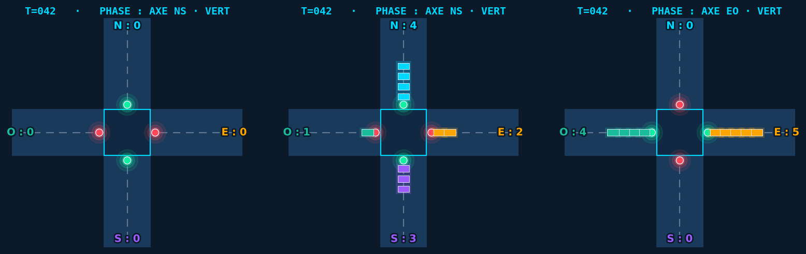
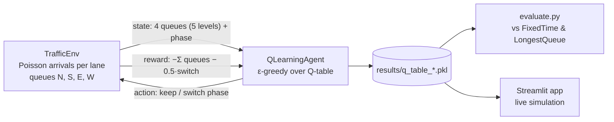
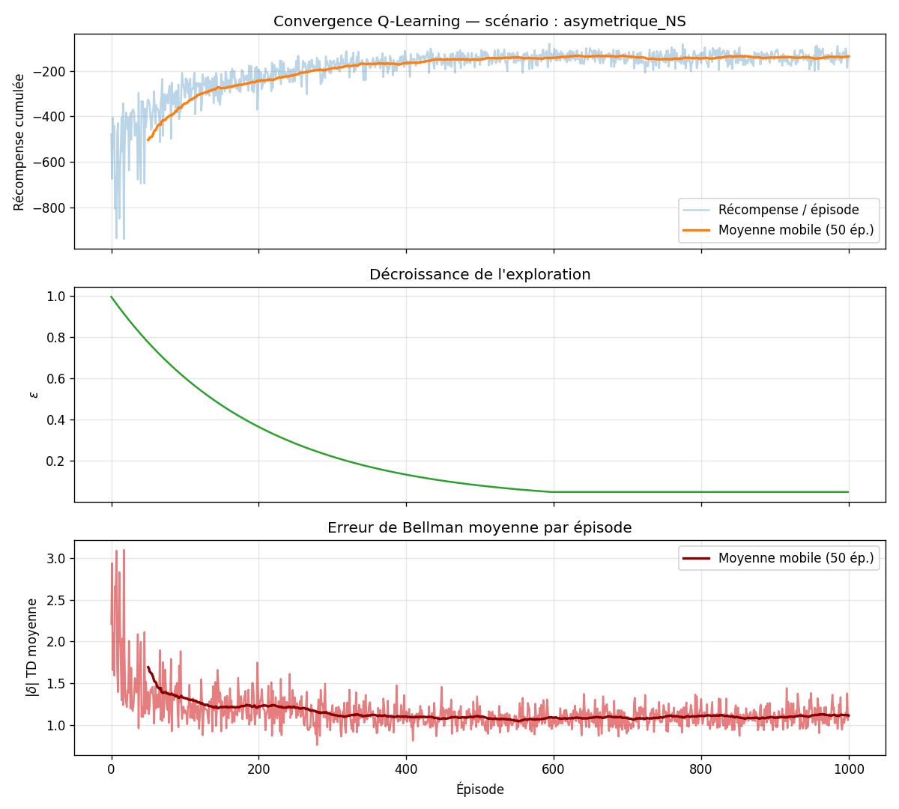
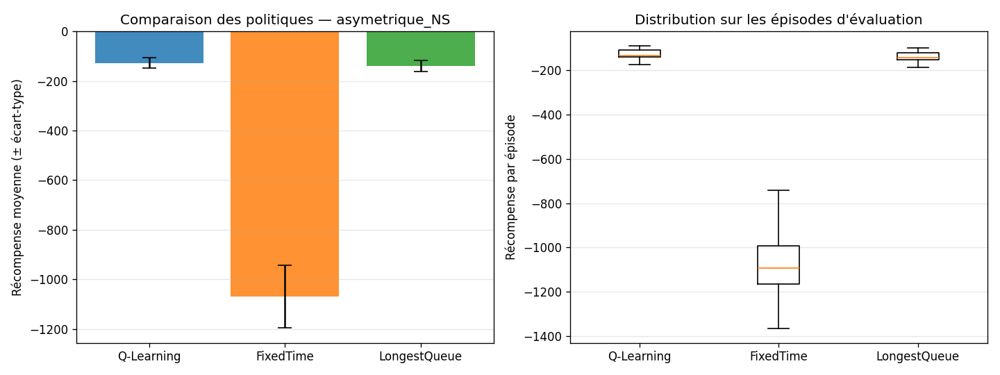

# Smart Traffic Light Control with Q-Learning

A tabular Q-Learning agent, written from scratch in NumPy, that controls the traffic light of an isolated
4-way intersection and is compared against two hand-written baselines.

> 🇫🇷 **Résumé** — Agent Q-Learning tabulaire, codé from scratch, qui pilote le feu d'un carrefour isolé
> à 4 branches (arrivées de Poisson). Il est comparé à deux politiques de référence (feu à durée fixe et
> « plus longue file ») sur plusieurs scénarios de trafic, avec une démo Streamlit en direct.

## Demo



<!-- TODO: add a GIF of the Streamlit "Simulation live" page (cars queuing and clearing, ~10 s) -->

Run the live demo locally with `streamlit run app/streamlit_app.py` (see [Run locally](#run-locally)).

## The problem

Fixed-time traffic lights ignore the actual traffic: they give the same green time to an empty street as to a
saturated one. The goal of this course project was to model a single intersection as a Markov Decision
Process, train an agent that learns *when* to switch phases from experience alone (the arrival dynamics are
unknown to it), and measure whether it beats simple rule-based controllers. This is Part 1 of a two-part
project; Part 2 (a network of cooperating intersections) is not in this repo.

## Approach



- **Environment** (`src/environment.py`): each time step, vehicles arrive on each lane following a Poisson
  process with rate λᵢ; the green axis (N/S or E/W) discharges a fixed number of cars. Episodes last 200
  steps. A phase change costs a 0.5 penalty, which models the amber transition and discourages flapping.
- **Agent** (`src/agent.py`): tabular Q-Learning with ε-greedy exploration and ε decay. The Q-table is a
  plain dict, filled lazily.
- **Baselines** (`src/baseline.py`): `FixedTime` (switches every 10 steps) and `LongestQueue` (a purely
  reactive rule: green goes to the axis with the larger total queue; keep the phase on ties).

### MDP

| Component | Choice |
|---|---|
| States S | (qN, qS, qE, qW, phase), each queue discretized to 5 levels → \|S\| = 5⁴ × 2 = 1250 |
| Actions A | {Keep phase, Switch phase} |
| Reward R | −Σ(queue lengths) − 0.5 × switch |
| Discount γ | 0.95 |
| Dynamics T | Stochastic (Poisson arrivals), unknown to the agent, which is why model-free Q-Learning fits |
| Agent architecture | Hybrid: perception (state) + learning (Q-table) + exploitation |

### Hyperparameters

| Hyperparameter | Value | Rationale |
|---|---|---|
| α (learning rate) | 0.1 | Balance between stability and speed |
| γ (discount) | 0.95 | Long horizon: future throughput matters |
| ε₀ | 1.0 | Full exploration at the start |
| ε_min | 0.05 | Residual exploration |
| ε_decay | 0.995 | Reaches ε_min after ~600 episodes |

### Scenarios

| Scenario | λ (N, S, E, W) |
|---|---|
| `equilibre` (balanced) | 0.3, 0.3, 0.3, 0.3 |
| `asymetrique_NS` | 0.6, 0.6, 0.1, 0.1 |
| `asymetrique_EO` | 0.1, 0.1, 0.6, 0.6 |
| `trafic_dense` | 0.5, 0.5, 0.5, 0.5 |

Trained Q-tables are committed for `equilibre` and `asymetrique_NS` only.

## Results

Metric: **mean episode return** G (higher is better; it is minus the total waiting cars over a 200-step
episode, minus the switch penalties), ± standard deviation over **30 evaluation episodes**. All three
policies see the same arrival sequences (seed 123). Source: [`results/evaluation_summary.csv`](results/evaluation_summary.csv).

| Scenario | Q-Learning | LongestQueue | FixedTime | Q-table trained for |
|---|---|---|---|---|
| Balanced (λ = 0.3 everywhere) | −217 ± 53 | **−183 ± 16** | −790 ± 83 | 800 episodes |
| Asymmetric N/S (λ_NS = 0.6, λ_EW = 0.1) | **−127 ± 21** | −139 ± 21 | −1070 ± 126 | 1000 episodes |

Episode counts come from `results/metrics_<scenario>.json`.

What this shows: the learned policy clearly beats the fixed-time light in both scenarios (a return about
3.6× better on balanced traffic and 8× better on asymmetric traffic). The adaptive `LongestQueue` rule
remains a strong baseline: it beats the agent on balanced traffic.

> **Reproducibility note.** Re-running `python scripts/evaluate.py --scenarios equilibre asymetrique_NS`
> on the committed Q-tables reproduces the baselines exactly and the balanced Q-Learning score
> (−215.7 to −218.1 over 5 runs). On asymmetric N/S it gives **−137.9 to −140.7**, which is a tie with
> LongestQueue rather than the −127 in the CSV, so the CSV row was most likely produced by an earlier
> training run. The scores vary between runs because greedy ties are broken by an unseeded RNG, and every
> state never seen during training is a tie.

Training curves and comparison plots:

| Convergence (asymmetric N/S) | Comparison (asymmetric N/S) |
|---|---|
|  |  |

## Tech stack

Python · NumPy · Pandas · Matplotlib · Seaborn · Streamlit

## Run locally

Tested with Python 3.14 on Windows; `requirements.txt` only sets minimum versions.

```bash
python -m venv .venv
source .venv/bin/activate            # Linux/Mac
# .venv\Scripts\activate             # Windows
pip install -r requirements.txt
```

**1. Train the agent** (writes `q_table_<scenario>.pkl`, `metrics_<scenario>.json` and
`convergence_<scenario>.png` to `results/`, overwriting the committed ones)

```bash
python scripts/train.py                                   # balanced scenario, 1000 episodes
python scripts/train.py --scenario asymetrique_NS --episodes 1500
```

Scenarios: `equilibre`, `asymetrique_NS`, `asymetrique_EO`, `trafic_dense`.

**2. Evaluate / compare** (prints a summary table, writes `results/evaluation_summary.csv` and
`results/comparison_<scenario>.png`)

```bash
python scripts/evaluate.py --scenarios equilibre asymetrique_NS --episodes 30
```

**3. Live demo**

```bash
streamlit run app/streamlit_app.py
```

Three pages: **Simulation live** (the intersection drawn step by step), **Comparaison politiques** (bar chart
of the policies over N episodes), **Courbes d'apprentissage** (Q-Learning convergence). The app UI is in
French.

## Project structure

```
.
├── src/
│   ├── environment.py      # Intersection simulation (MDP, Poisson arrivals, queues), scenarios
│   ├── agent.py            # Q-Learning agent (from scratch)
│   ├── baseline.py         # FixedTime + LongestQueue reference policies
│   └── utils.py            # Discretization, save/load, seeding
├── scripts/
│   ├── train.py            # Training loop + convergence plot
│   └── evaluate.py         # Q-Learning vs baselines
├── app/
│   └── streamlit_app.py    # Live demo and visualizations
├── results/                # Q-tables, JSON metrics, PNG plots, evaluation CSV
├── .streamlit/config.toml  # App theme
└── requirements.txt
```

## Limitations & next steps

- **Tabular approach does not scale.** Even with 5 levels per lane, the agent visited only 311 (balanced) and
  254 (asymmetric) of the 1250 states during training (`n_states_seen` in the metrics files). Queues longer
  than the top level all look the same to the agent. A function approximator (e.g. DQN) would be the next
  step.
- **Unseen states act randomly.** At evaluation time, a state that was never visited has all-zero Q-values
  and the action is picked at random; seeding the agent's RNG in `evaluate.py` would make results
  reproducible.
- **The committed CSV and Q-tables are out of sync** for the asymmetric scenario (see the note above).
- **No Q-tables for `asymetrique_EO` and `trafic_dense`.** They are defined but were not trained or evaluated.
- **Simplified traffic model:** one isolated intersection, Poisson arrivals, a constant discharge rate,
  no turning movements or pedestrians.
- **Next:** Part 2 of the course project extends this to a network of intersections controlled by
  cooperating agents.

## Context

Course project for *Intelligence Artificielle Distribuée & Systèmes Multi-Agents* (Reinforcement Learning
module, Pr. Issam Qaffou), engineering cycle, 2025–2026.
<!-- TODO (Adil): state whether this was solo or a team project, and your role if team. -->

## Author

**Adil Bouhoum**: [LinkedIn](https://www.linkedin.com/in/adil-bouhoum-b83129232) · [GitHub](https://github.com/Adil-Bouhoum)
